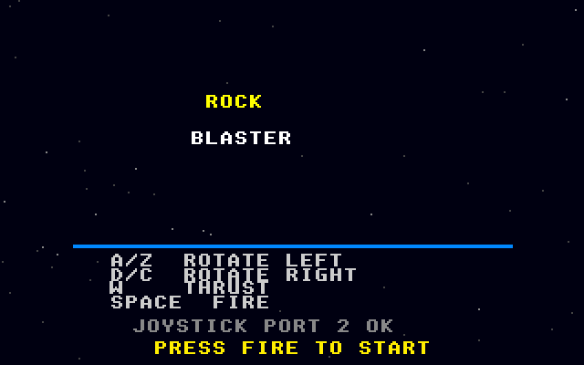
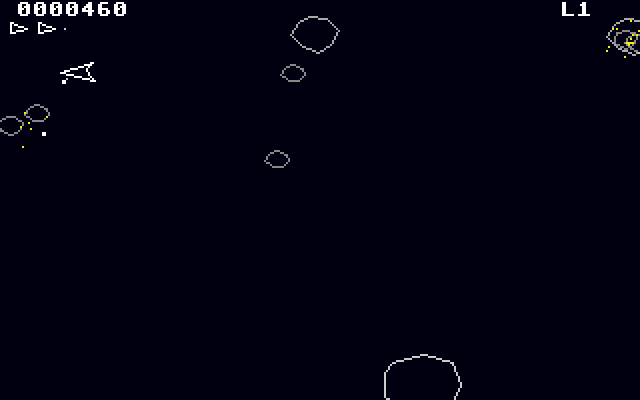

# Rock Blaster
**Platform:** Atari Atari STE (Hatari) · **Source:** `atari_st_games/rock_blaster/` · **Type:** game

A vector rock shooter: rotate, thrust and blast drifting rocks that split into smaller ones. It is a port of the Amiga original (`examples/rock_blaster` in amiga_mcp) on `st_port`; `game.c` and `draw.c` are unmodified apart from one block that draws each rock outline once with the original polygon code into a pre-shifted sprite, since the rocks never rotate. Speed work was done with the agent API's profiler. Captured through the agent API with injected joystick input.

## Title screen

"ROCK" and "BLASTER" on a starfield, a blue rule, the key list (A/Z rotate left, D/C rotate right, W thrust, Space fire), JOYSTICK PORT 2 OK and PRESS FIRE TO START.

## Gameplay

Level 1 just started: the ship in the middle fires a line of shots upward with its orange thrust flame showing, among large white outline rocks. Score 0000000 and three ships in reserve.

## Gameplay: rocks breaking up

Later in level 1 the large rocks have broken into medium and small ones; score 0000460.

**Controls:** Cursor keys, A/Z, D/C or joystick: rotate · Up, W or joystick up: thrust · Space, Alt or fire: shoot · Esc: quit
