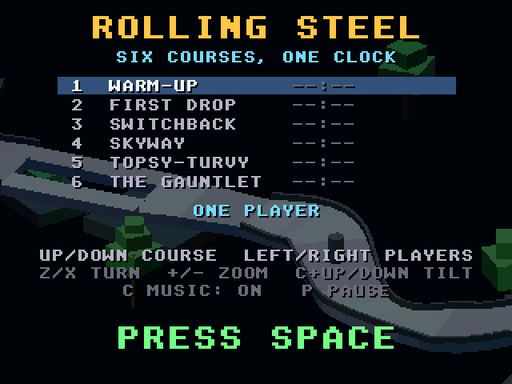
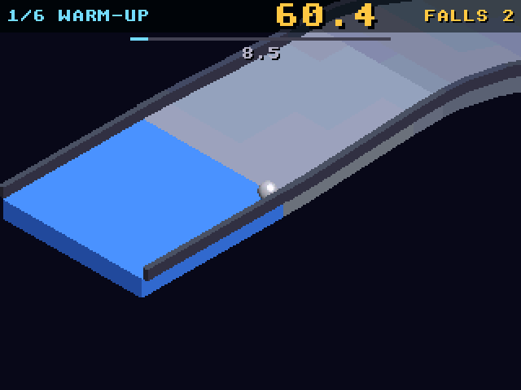

# Rolling Steel
**Platform:** Atari Falcon + 68060 (CT60) (Hatari) · **Source:** `atari_st_games/rolling_steel/` · **Type:** game

A marble-racing game over six floating 3D courses against one clock, another of amiga_mcp's 3DO ports (`examples/rolling_steel`). Its 3D is rasterised in software with a depth buffer sized for an Amiga 68060, so a stock Falcon030 manages 1-2 fps; it runs on an accelerated Falcon (68060 at 32 MHz with 64 MB TT-RAM, CT60-style) through the `falcon_3do` layer. The game, physics and course code are unmodified; the port adds `fastcel.c`, a fast far-to-near renderer, and draws straight into RGB565. Captured through the agent API, whose console showed `ROLL I fps=33.0` during play.

## Title screen

"ROLLING STEEL / SIX COURSES, ONE CLOCK" over the 3D course with trees: the course list from 1 Warm-Up to 6 The Gauntlet with no times yet, ONE PLAYER, the keys and PRESS SPACE.

## Gameplay

Course 1, Warm-Up, zoomed out: the steel marble in the air above the grey track, with a blocky green tree; clock 9.3, FALLS 9.

## Gameplay: start

The marble on the blue start section of Warm-Up at the default zoom; clock 60.4, FALLS 2.

**Controls:** Cursor keys or joystick: push · Z / X: turn the view · +/-: zoom · C + up/down: tilt · F: display mode · P: pause · Esc: quit · Title: up/down course, left/right players, C music, Space: start
