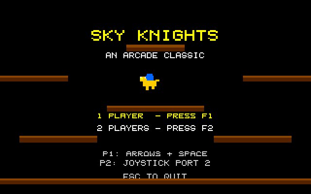
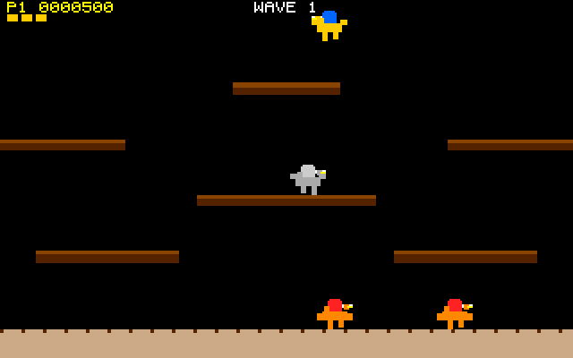

# Sky Knights
**Platform:** Atari Atari STE (Hatari) · **Source:** `atari_st_games/sky_knights/` · **Type:** game

Aerial jousting on winged mounts for one or two players: strike opponents from above and grab the pods they drop before they hatch. It is a port of the Amiga original (`examples/sky_knights` in amiga_mcp) on `st_port`; `game.c` and the generated samples are unmodified, `sound.c` is pointed at the Paula emulation (STE DMA sound), and text and the playfield are drawn as cached layers. Captured through the agent API with injected keys.

## Title screen

"SKY KNIGHTS / AN ARCADE CLASSIC" with the player's yellow mount between ledges, 1 PLAYER - PRESS F1, 2 PLAYERS - PRESS F2, and P1 arrows + space, P2 joystick port 2.

## Gameplay

Wave 1: the yellow-and-blue player knight flies between brown ledges while three red-and-orange enemy riders patrol the ground and one flies on the left; P1 0000000, three lives.

## Gameplay: a grey knight

Later in the wave the player is up at the top, a grey enemy rider stands on the middle ledge and two red riders are on the ground; P1 0000500.

**Controls:** P1: cursor keys / A,D move, up / W / Space flap · P2: joystick, up or fire flaps · F1 / F2: 1 or 2 players · Esc: quit
