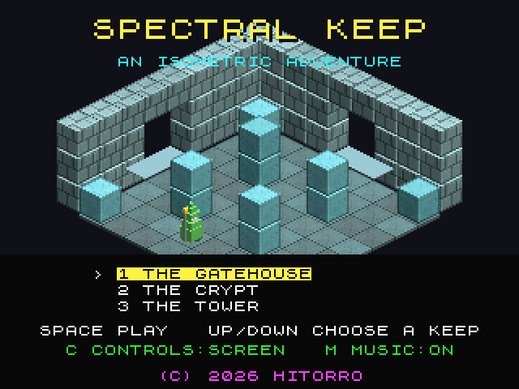
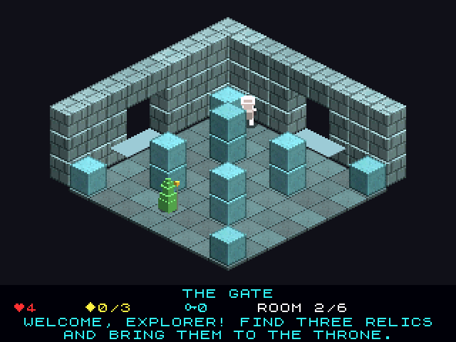

# Spectral Keep
**Platform:** Atari Falcon030 (Hatari) · **Source:** `atari_st_games/spectral_keep/` · **Type:** game

An isometric flip-screen adventure in the style of Knight Lore: three keeps and 24 rooms, where you carry relics to the throne while avoiding guards, hounds, ghosts, bouncers and spikes. In amiga_mcp it is one of the 3DO ports (`examples/spectral_keep`) with a classic 68k AmigaOS build; this port runs that build on the `falcon_3do` layer, which supplies its small machine layer (window, keyboard, timer, Paula sound) on the Falcon so the game code and its `main_68k.c` compile unchanged. The room compositor gains an RGB565 mode so it composes straight into the Falcon's true-colour screen. Captured through the agent API.

## Title screen

"SPECTRAL KEEP / AN ISOMETRIC ADVENTURE" above the Gatehouse room with ice-blue blocks and the green explorer, the keep menu (1 The Gatehouse highlighted, 2 The Crypt, 3 The Tower), SPACE PLAY, C CONTROLS:SCREEN and M MUSIC:ON.

## Gameplay

The mossy green Courtyard: stacked green blocks with a yellow relic on top, a white guard and a red hound, and a green gate at the left; THE GATEHOUSE, 4 lives, relics 0/3.

## Gameplay: the gate

The Gate room, with the welcome message along the bottom: "WELCOME, EXPLORER! FIND THREE RELICS AND BRING THEM TO THE THRONE."

**Controls:** Cursor keys / WASD or joystick: walk · Space: jump / start · Title: up/down keep, C controls, M music · P: pause · Esc: quit
