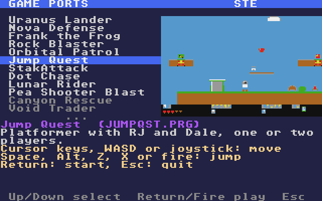
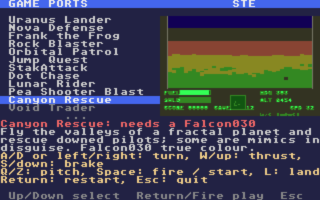

# ST Launcher
**Platform:** Atari STE (Hatari) · **Source:** `atari_st_games/st_launcher/` · **Type:** tool

A menu that runs on the Atari itself: `make_drive.py` reads the same `games.ini` as the host launcher and puts every port on one C: drive (`GAMES\<NAME>\` with each game's files and a 160x100 `THUMB.DAT` made from its screenshot), and `LAUNCHER.PRG` lists them, shows the thumbnail, description and controls, and starts the chosen game with `Pexec`; quitting the game returns to the menu. Text goes through the TOS VT52 console in ST low resolution, and each thumbnail uses pens 8-15 with eight colours picked from the game's own palette. The machine is read from the `_MCH` cookie, and games it can't run are greyed out. Run under `make_drive.py --run`, a supervisor watches the agent API's `/console` for `LAUNCHER SWITCH` and reboots Hatari as a Falcon030 or STE through `/config` when you pick a game for the other machine. These shots are from an STE with 4 MB, booted on the prebuilt `build/drive` without the supervisor.

## Menu

GAME PORTS on an STE: the list from Uranus Lander to Void Trader with Uranus Lander highlighted, its thumbnail (a landing with the "x2 BONUS" message), the description and the controls, and the Up/Down select · Return/Fire play footer.

## Another entry

Jump Quest selected: the thumbnail shows its level 1 and the text gives its description and controls.

## A game for the other machine

Canyon Rescue and Void Trader are greyed out on the STE. Selecting Canyon Rescue shows "Canyon Rescue: needs a Falcon030" in red over its description.

**Controls:** Up/Down or joystick: select · Return, Space or fire: play · M: switch machine (with the supervisor) · Esc: quit to the desktop
