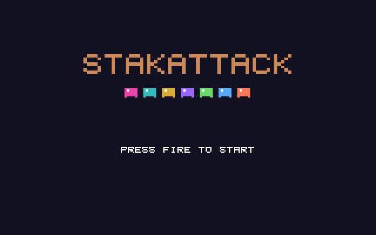

# StakAttack
**Platform:** Atari Atari STE (Hatari) · **Source:** `atari_st_games/stakattack/` · **Type:** game

A falling-gem puzzle game in a 12 x 19 well. It is a port of the Amiga original (`examples/stakattack` in amiga_mcp) on `st_port`: `game.c` is unmodified, the original MOD ("Stack Bounce") plays on the C ptplayer over the Paula emulation on STE DMA sound, and `draw.c` caches text and gems as layer operations re-rendered only when they change. Captured through the agent API with keys held through `/input/key`.

## Title screen

The orange "STAKATTACK" logo above a row of seven coloured gems and PRESS FIRE TO START.

## Gameplay

A tall uneven stack of pink, green, yellow, blue, teal and purple gems in the well, a pink piece being placed at the top, POINTS 186, ROWS 0, STAGE 1 and a blue piece COMING UP.

**Controls:** Cursor keys / WASD or joystick: move, up / W: rotate · Down / S: soft drop · Space / fire: hard drop · P: pause · Esc: quit
