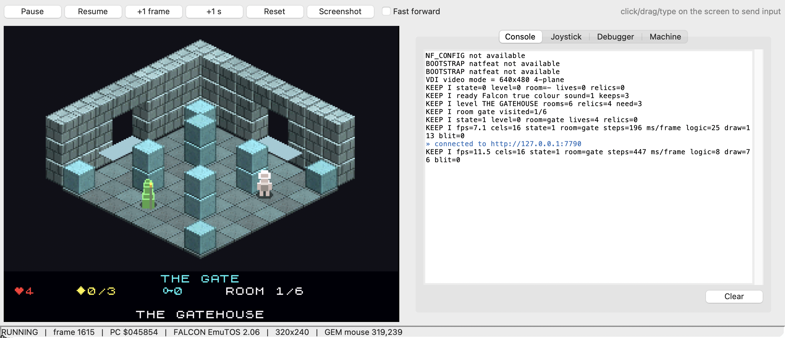
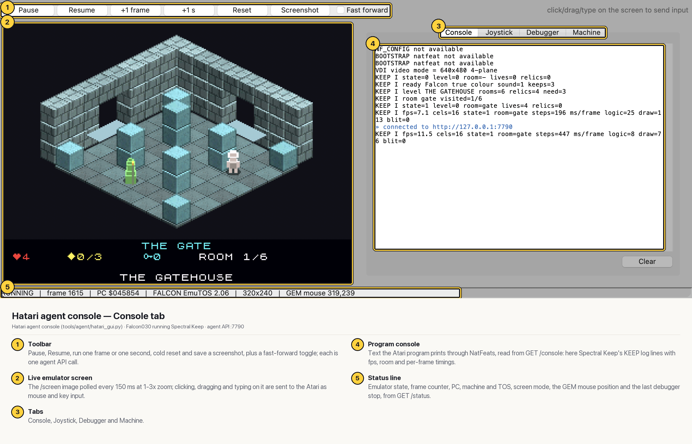
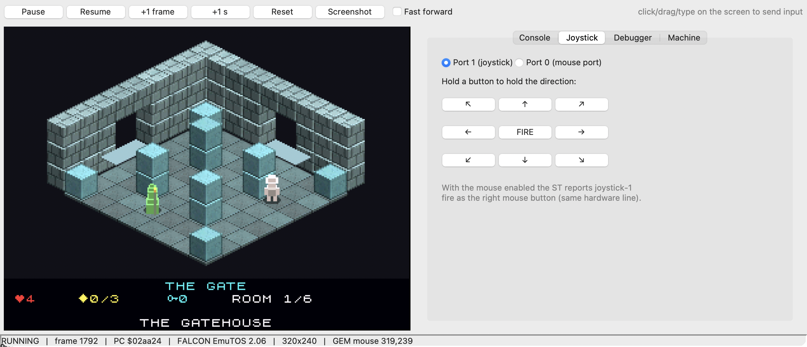
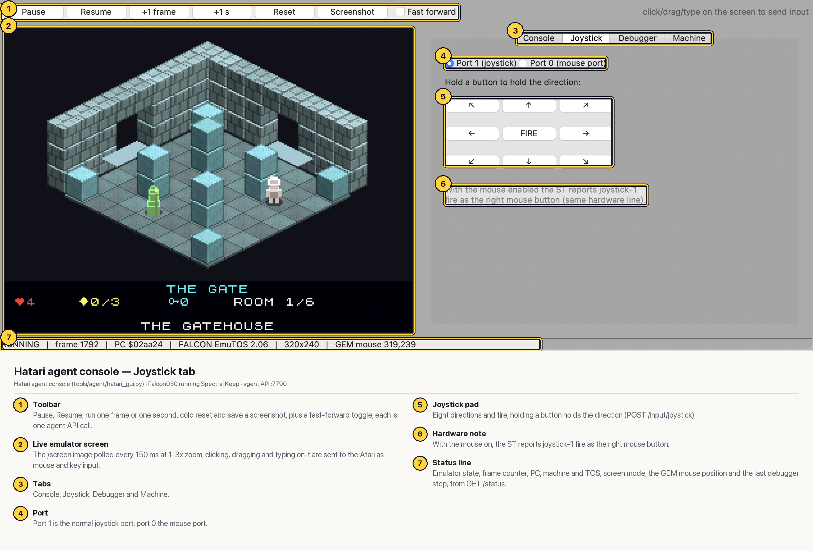
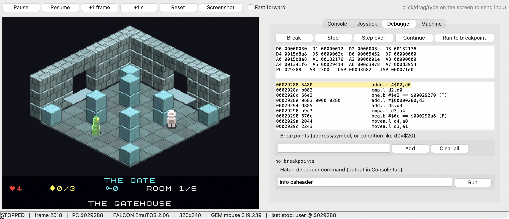
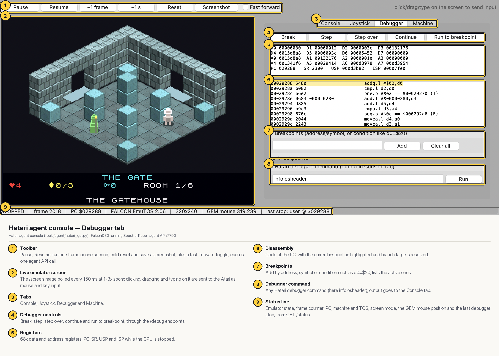
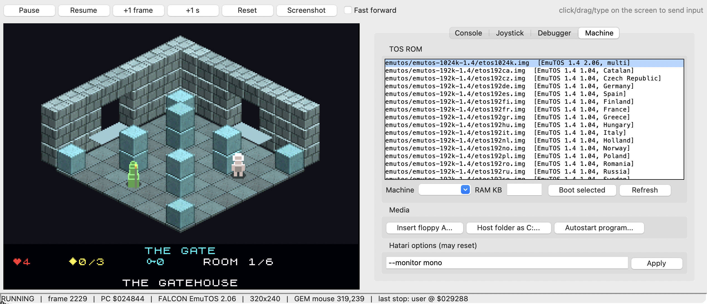
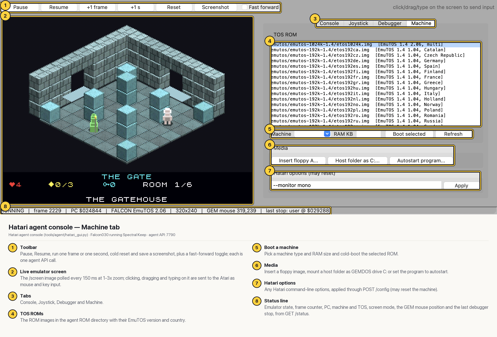
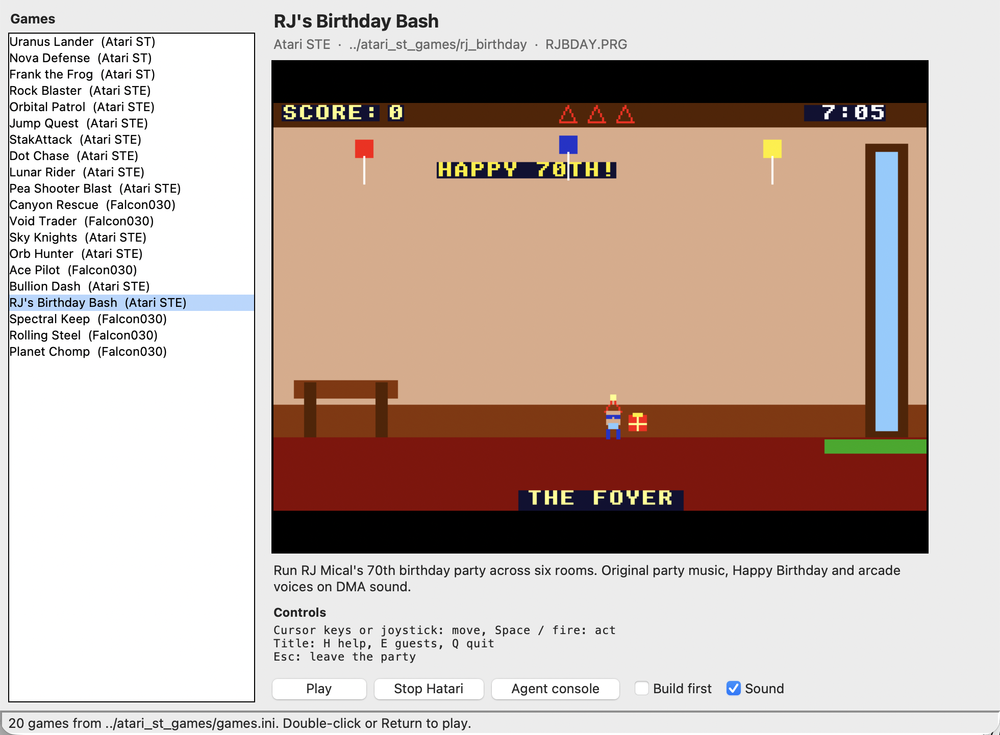
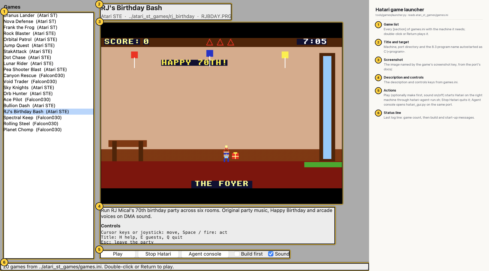

# Hatari agent tooling

The Atari ports were built, played and tested through **hatari_augmented**, a patched Hatari with an HTTP **agent API** (`--agent-port`, documented in its `doc/agent-api.md`). Everything a person does at the emulator is an endpoint, and every endpoint answers JSON except the screenshot:

| Area | Endpoints |
|---|---|
| Emulation | `GET /status`, `POST /emu/pause` `/emu/resume` `/emu/run?frames=N` `/emu/reset` `/emu/fastforward` `/emu/quit` |
| Machine and media | `POST /config` (Hatari options, e.g. `--machine falcon --memsize 14`), `GET /roms`, `/media/floppy` `/media/harddrive` `/media/autostart` |
| Screen | `GET /screen`: PNG at the native emulated resolution (320x200, 320x240 Falcon VGA...), so pixel coordinates are mouse coordinates |
| Input | `/input/type`, `/input/key` (press, or hold with `action=down`/`up`), `/input/mouse`, `/input/click`, `/input/joystick` |
| Memory and CPU | `GET`/`POST /mem`, `/cpu/regs`, `/cpu/disasm` |
| Debugger | `/debug/break` `/debug/step` `/debug/next` `/debug/continue?wait=1`, `/debug/breakpoints`, `/debug/cmd` (any Hatari debugger command, including the profiler) |
| State and output | `/state/save` `/state/load`, `GET /console`: what the Atari program prints through NatFeats |

Around it:
- `tools/agent/hatari-agent-run.sh` starts Hatari with the API on a port and waits until it answers. Each port's `make run` calls it with the game's machine, `--natfeats on`, `build/` as drive C: and the program autostarted.
- `tools/agent/hatari_agent.py` is a stdlib Python client (`h.screen()`, `h.joystick("left,fire")`, `h.read_mem(addr)`...). The games' bots and tests use it: `nova_defense/bot.py`, `uranus_lander/autopilot.py` (a closed loop that breaks on the frame swap, reads the ship from `/mem` and sets the joystick) and `canyon_rescue/rescue_test.py`.
- The games log `<TAG> SYMBOL <name> 0x<addr>` lines at start-up, so scripts find the game state in memory from `/console` without a symbol table. Their Amiga bridge hooks become `/mem` writes.
- Two Tk windows: the agent console and the game launcher, below.

All the Atari screenshots in this portfolio were taken with `GET /screen` and scaled 2x with nearest-neighbour; the two Tk windows were captured with macOS `screencapture` of the window's area.

| Screen | Plain | Annotated |
|---|---|---|
| [Agent console: Console](agent-console-console.md) |  |  |
| [Agent console: Joystick](agent-console-joystick.md) |  |  |
| [Agent console: Debugger](agent-console-debugger.md) |  |  |
| [Agent console: Machine](agent-console-machine.md) |  |  |
| [Game launcher](game-launcher.md) |  |  |

Annotation specs for `portfolio/tools/annotate.py` are in `annotations/`.
