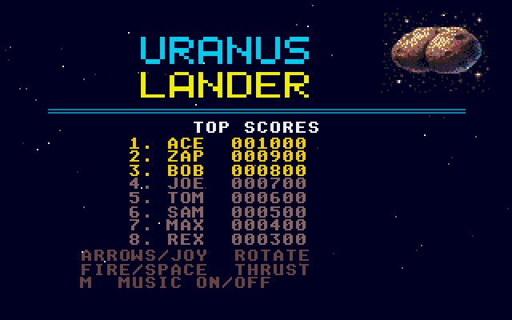
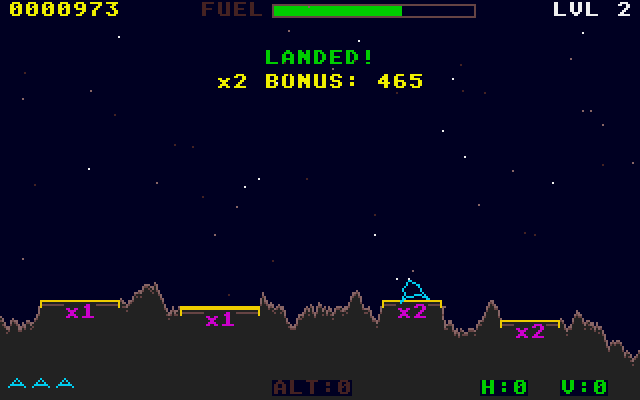

# Uranus Lander
**Platform:** Atari Atari ST (Hatari) · **Source:** `atari_st_games/uranus_lander/` · **Type:** game

A lunar-lander game: rotate and thrust down onto the landing pads of generated terrain before the fuel runs out. It is a port of the Amiga original (`examples/uranus_lander` in amiga_mcp) on the shared ST layer (`st_port`): `game.c` is unchanged apart from high-score file I/O, and `draw.c`'s graphics.library calls run on `st_gfx`, which keeps the 320x256 Amiga coordinates and maps Y onto the ST's 200 lines. A plain ST has no sample playback, so the ProTracker music and Paula effects became synthesised YM2149 sound and a small chiptune. The port was built and tested entirely through the Hatari agent API; `autopilot.py` flies it in a closed loop (break on the per-frame swap, read the ship from `/mem`, set the joystick), and the gameplay shots were taken while it played.

## Title screen

The cyan and yellow "URANUS / LANDER" logo with the cratered planet picture at the top right, the TOP SCORES table (ACE 001000 down to REX 000300) and the control hints: arrows/joystick rotate, fire/space thrust, M music on/off.

## Gameplay

Level 3 with the autopilot flying: the cyan lander descends with its thrust flame lit over grey rocky terrain with yellow pads marked x1, x2, x2 and x3. The HUD shows score 0000973, the green FUEL bar, LVL 3, ALT:74 and velocity H:0 V:8.

## Gameplay: landed

The autopilot has just set down on a x2 pad on level 2: "LANDED! x2 BONUS: 465", score 0000973 and three reserve landers at the bottom left.

**Controls:** Cursor keys / A,D or joystick: rotate · Space / W, fire or up: thrust · M: music on/off · Esc: quit
