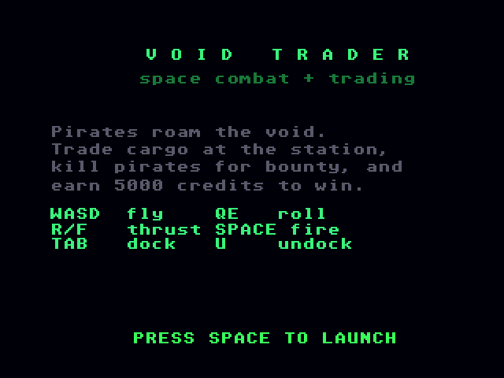
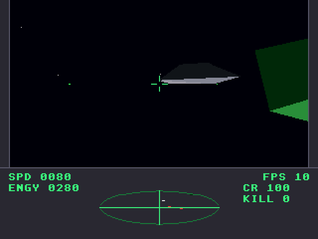

# Void Trader
**Platform:** Atari Falcon030 (Hatari) · **Source:** `atari_st_games/void_trader/` · **Type:** game

Space combat and trading in filled 3D: fly with six degrees of freedom, fight pirates, dock to trade and earn 5000 credits to win. The Amiga original (`examples/void_trader` in amiga_mcp) is AGA, so the port runs on the Falcon layer in 16-bit true colour; the 3D engine, models, combat, trade and the game's own MOD player are unmodified, and the layer adds the `AreaMove`/`AreaDraw`/`AreaEnd` polygon fills the engine needs. Music and effects play through the Paula emulation on Falcon DMA sound. Captured through the agent API; the HUD shows the frame rate (10-27 fps here).

## Title screen

Green "V O I D  T R A D E R / space combat + trading", the briefing (pirates roam the void, trade cargo at the station, kill pirates for bounty, earn 5000 credits to win), the keys and PRESS SPACE TO LAUNCH.

## Gameplay

In flight: a large green shaded cube object in the crosshair, a dark grey ship to the left and red pirate shapes at the edges; the console shows SPD 0042, ENGY 0880, FPS 19, CR 100 and the elliptical scanner.

## Gameplay: close pass

A dark grey ship crosses the crosshair with a green object at the right; SPD 0080, FPS 10.

**Controls:** W/S pitch, A/D yaw, Q/E roll, R/F thrust · Space: fire / start · Tab: dock, U: undock · Docked: W/S select, B buy, N sell · Esc: quit
