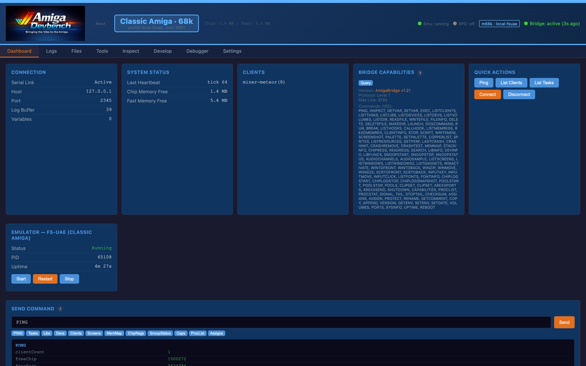
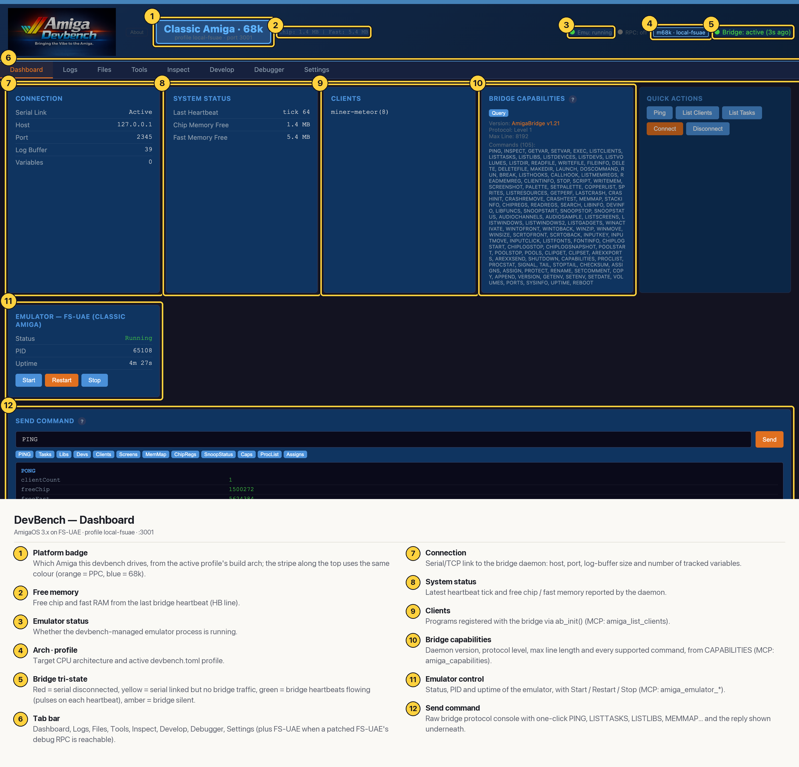

# DevBench — Dashboard (Classic 68k)

The landing page: one glance tells you which Amiga this devbench drives, whether the serial/TCP link and the Amiga-side bridge daemon are alive, which bridge clients are registered and how much memory is free. It also holds emulator Start/Restart/Stop and a raw protocol console for poking the daemon directly. The same facts are available to Claude Code through MCP (`amiga_ping`, `amiga_list_clients`, `amiga_capabilities`, `amiga_emulator_status`). On this target the badge and stripe are blue, and the emulator card manages FS-UAE.

## Annotated

1. **Platform badge** — Which Amiga this devbench drives, from the active profile's build arch; the stripe along the top uses the same colour (orange = PPC, blue = 68k).
2. **Free memory** — Free chip and fast RAM from the last bridge heartbeat (HB line).
3. **Emulator status** — Whether the devbench-managed emulator process is running.
4. **Arch · profile** — Target CPU architecture and active devbench.toml profile.
5. **Bridge tri-state** — Red = serial disconnected, yellow = serial linked but no bridge traffic, green = bridge heartbeats flowing (pulses on each heartbeat), amber = bridge silent.
6. **Tab bar** — Dashboard, Logs, Files, Tools, Inspect, Develop, Debugger, Settings (plus FS-UAE when a patched FS-UAE's debug RPC is reachable).
7. **Connection** — Serial/TCP link to the bridge daemon: host, port, log-buffer size and number of tracked variables.
8. **System status** — Latest heartbeat tick and free chip / fast memory reported by the daemon.
9. **Clients** — Programs registered with the bridge via ab_init() (MCP: amiga_list_clients).
10. **Bridge capabilities** — Daemon version, protocol level, max line length and every supported command, from CAPABILITIES (MCP: amiga_capabilities).
11. **Emulator control** — Status, PID and uptime of the emulator, with Start / Restart / Stop (MCP: amiga_emulator_*).
12. **Send command** — Raw bridge protocol console with one-click PING, LISTTASKS, LISTLIBS, MEMMAP… and the reply shown underneath.
