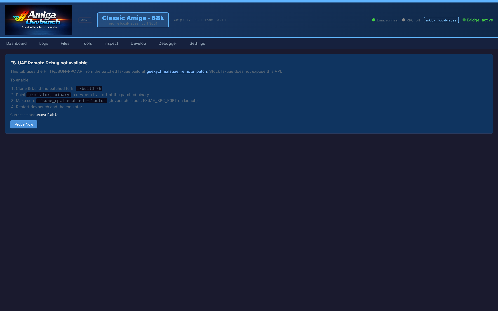
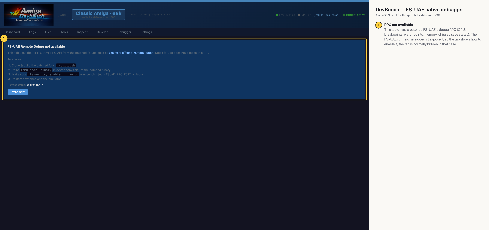

# DevBench — FS-UAE native debugger (Classic 68k)

Classic-68k only. With a patched FS-UAE build (geekychris/fsuae_remote_patch) that exposes an HTTP/JSON-RPC debug API, this tab gives CPU-level control without the bridge: pause/step, registers, breakpoints and watchpoints, memory, chipset registers and save states (MCP: `amiga_fsuae_*`). The FS-UAE running for this capture doesn't expose that RPC (probe status: unavailable), so the tab is normally hidden (it was opened directly for this screenshot) and shows how to enable it.

## Annotated

1. **RPC not available** — This tab drives a patched FS-UAE's debug RPC (CPU, breakpoints, watchpoints, memory, chipset, save states). The FS-UAE running here doesn't expose it, so the tab shows how to enable it; the tab is normally hidden in that case.
