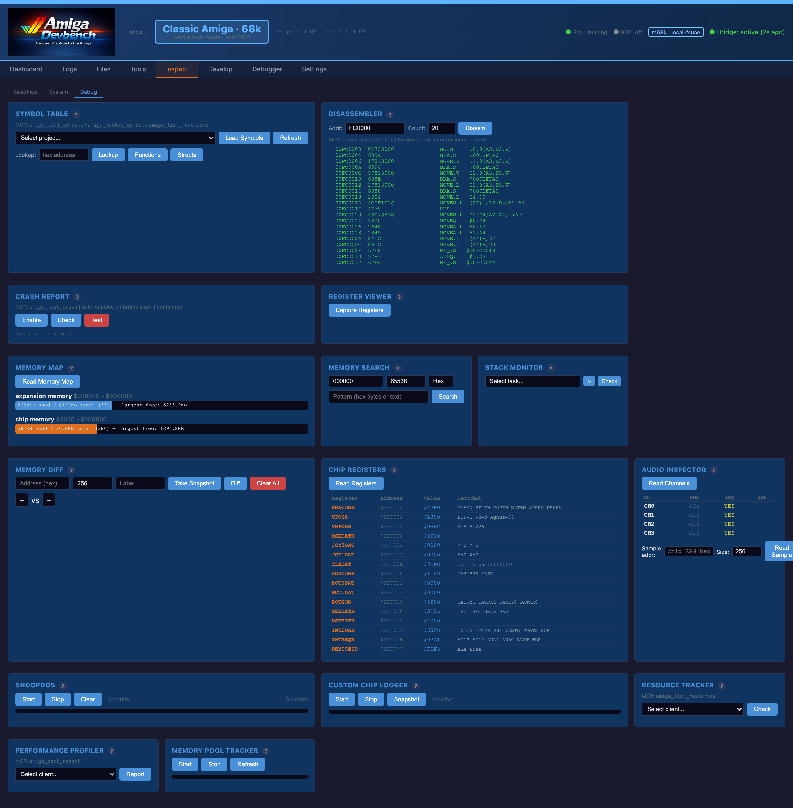
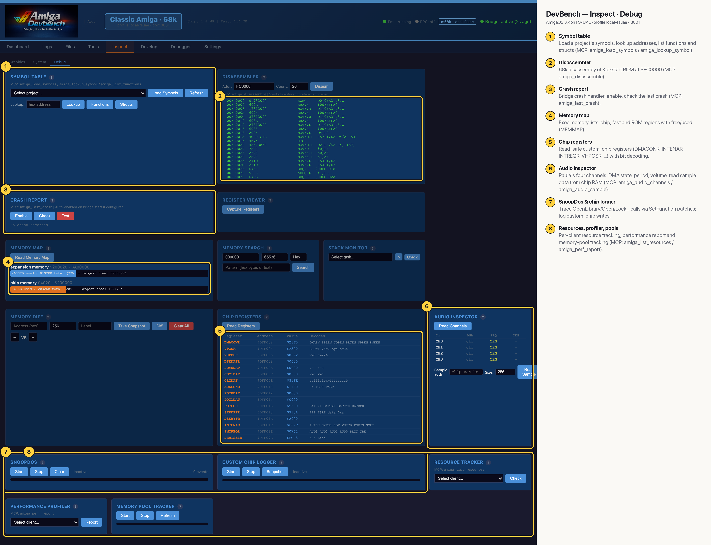

# DevBench — Inspect · Debug (Classic 68k)

Low-level debugging aids that work through the bridge: symbol loading and lookup, a disassembler, the crash handler's last report, the Exec memory map, memory search/diff, stack checks, custom-chip registers, Paula audio state, SnoopDos-style call tracing, a chip-write logger, and per-client resource, performance and pool tracking (MCP: `amiga_disassemble`, `amiga_last_crash`, `amiga_audio_channels`, `amiga_list_resources`, `amiga_perf_report`). This 68k capture shows the disassembler on Kickstart ROM at `$FC0000`, the chip/fast memory map, decoded custom-chip registers and Paula's four channels.

## Annotated

1. **Symbol table** — Load a project's symbols, look up addresses, list functions and structs (MCP: amiga_load_symbols / amiga_lookup_symbol).
2. **Disassembler** — 68k disassembly of Kickstart ROM at $FC0000 (MCP: amiga_disassemble).
3. **Crash report** — Bridge crash handler: enable, check the last crash (MCP: amiga_last_crash).
4. **Memory map** — Exec memory lists: chip, fast and ROM regions with free/used (MEMMAP).
5. **Chip registers** — Read-safe custom-chip registers (DMACONR, INTENAR, INTREQR, VHPOSR, …) with bit decoding.
6. **Audio inspector** — Paula's four channels: DMA state, period, volume; read sample data from chip RAM (MCP: amiga_audio_channels / amiga_audio_sample).
7. **SnoopDos & chip logger** — Trace OpenLibrary/Open/Lock… calls via SetFunction patches; log custom-chip writes.
8. **Resources, profiler, pools** — Per-client resource tracking, performance report and memory-pool tracking (MCP: amiga_list_resources / amiga_perf_report).
