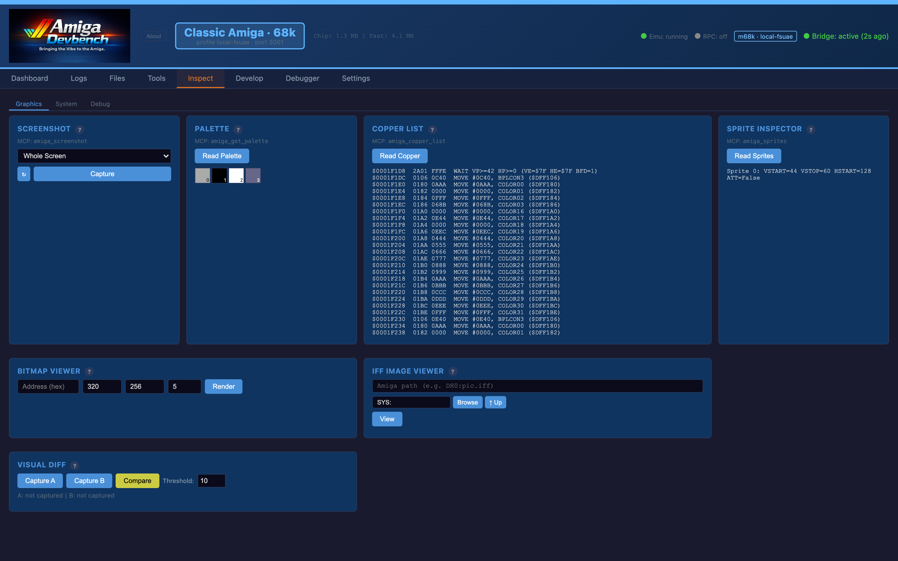
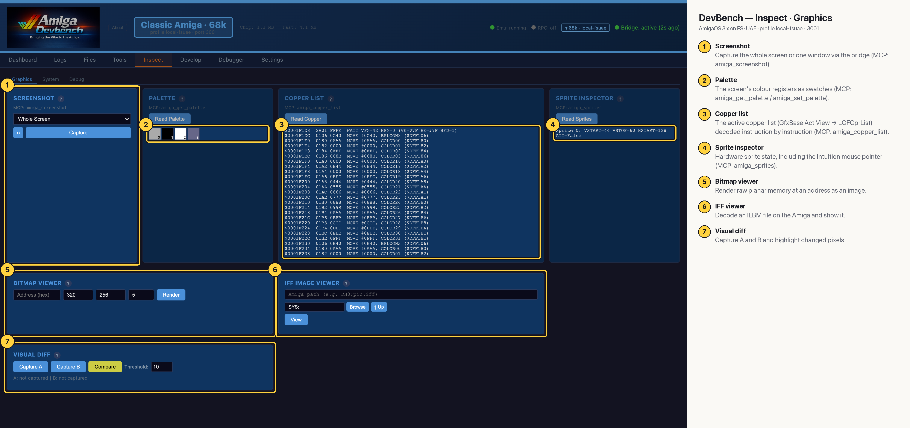

# DevBench — Inspect · Graphics (Classic 68k)

Graphics inspection tools: bridge screenshots of the screen or a single window, the palette, the active copper list, hardware sprites, a raw bitmap renderer, an IFF ILBM viewer and a visual diff between two captures (MCP: `amiga_screenshot`, `amiga_get_palette`, `amiga_copper_list`, `amiga_sprites`). On 68k the palette, copper list and sprite readers return real chipset data, here from a 4-colour screen.

## Annotated

1. **Screenshot** — Capture the whole screen or one window via the bridge (MCP: amiga_screenshot).
2. **Palette** — The screen's colour registers as swatches (MCP: amiga_get_palette / amiga_set_palette).
3. **Copper list** — The active copper list (GfxBase ActiView → LOFCprList) decoded instruction by instruction (MCP: amiga_copper_list).
4. **Sprite inspector** — Hardware sprite state, including the Intuition mouse pointer (MCP: amiga_sprites).
5. **Bitmap viewer** — Render raw planar memory at an address as an image.
6. **IFF viewer** — Decode an ILBM file on the Amiga and show it.
7. **Visual diff** — Capture A and B and highlight changed pixels.
