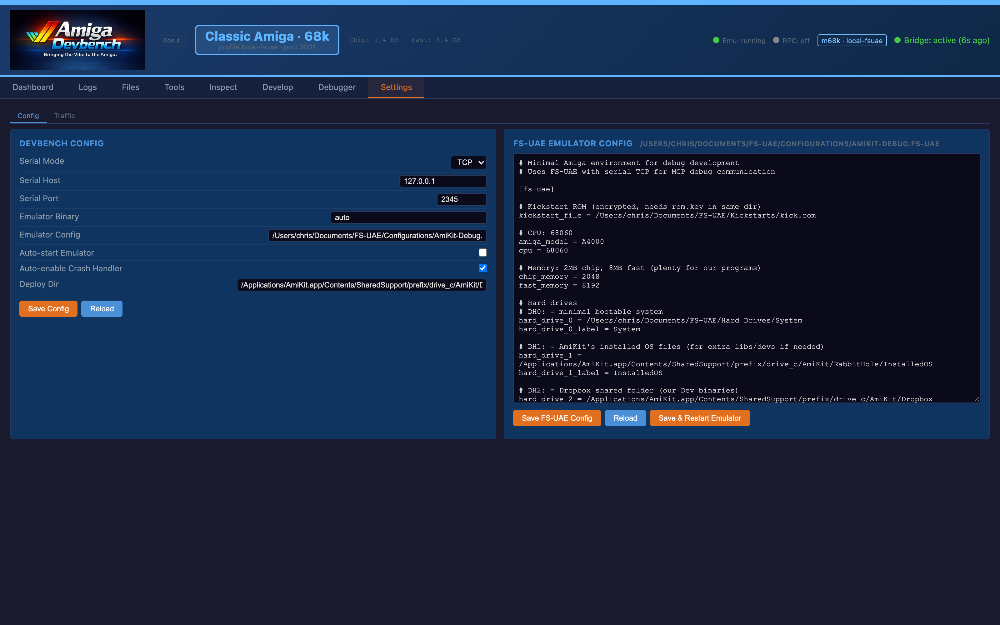
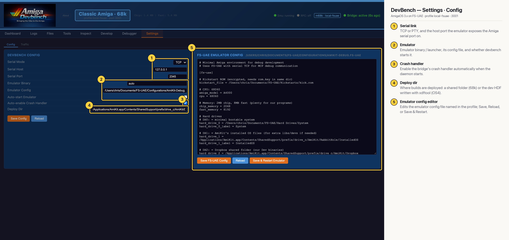

# DevBench — Settings · Config (Classic 68k)

Edits the active profile's settings: serial link, emulator binary and config, auto-start, crash-handler auto-enable and the deploy target. The right-hand pane edits the FS-UAE config file in place and can restart the emulator with it. For the qemu-os4 profile that pane is empty, since QEMU is started from a script and has no FS-UAE config. Here the editor shows the AmiKit-Debug FS-UAE config, whose header notes it uses serial over TCP for the bridge.

## Annotated

1. **Serial link** — TCP or PTY, and the host:port the emulator exposes the Amiga serial port on.
2. **Emulator** — Emulator binary / launcher, its config file, and whether devbench starts it.
3. **Crash handler** — Enable the bridge's crash handler automatically when the daemon starts.
4. **Deploy dir** — Where builds are deployed: a shared folder (68k) or the dev HDF written with xdftool (OS4).
5. **Emulator config editor** — Edits the emulator config file named in the profile; Save, Reload, or Save & Restart.
