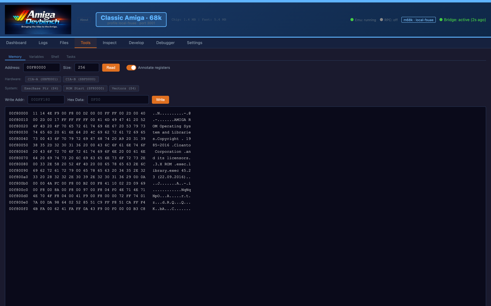
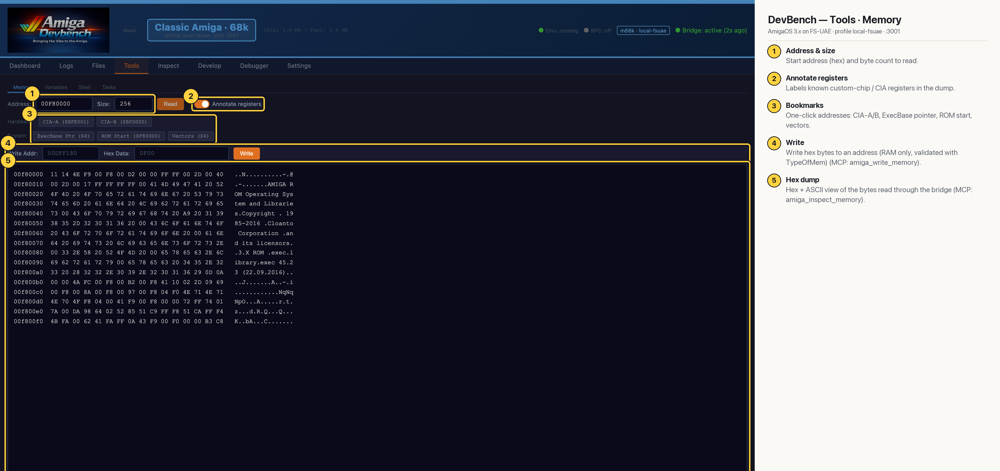

# DevBench — Tools · Memory (Classic 68k)

A hex/ASCII memory viewer and poker. Read any address through the bridge's INSPECT command, jump to common addresses with the bookmarks, and write hex bytes back (RAM only, validated with TypeOfMem). Classic-chipset addresses such as `$DFF000` and the CIAs only mean something on 68k (MCP: `amiga_inspect_memory`, `amiga_write_memory`). Here it shows the first 256 bytes of the Kickstart ROM at `$F80000`.

## Annotated

1. **Address & size** — Start address (hex) and byte count to read.
2. **Annotate registers** — Labels known custom-chip / CIA registers in the dump.
3. **Bookmarks** — One-click addresses: CIA-A/B, ExecBase pointer, ROM start, vectors.
4. **Write** — Write hex bytes to an address (RAM only, validated with TypeOfMem) (MCP: amiga_write_memory).
5. **Hex dump** — Hex + ASCII view of the bytes read through the bridge (MCP: amiga_inspect_memory).
