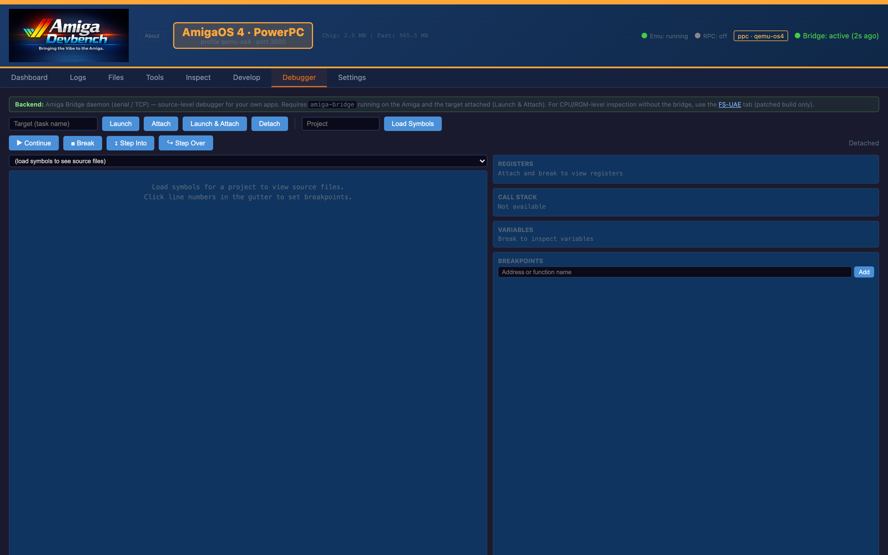
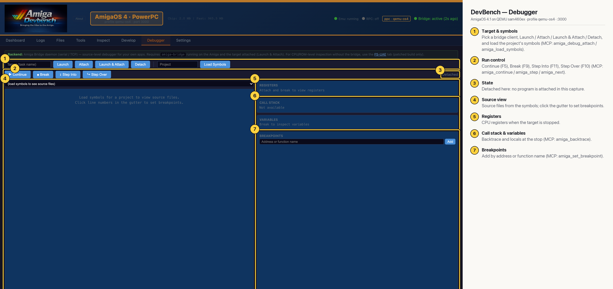

# DevBench — Debugger (AmigaOS 4 PPC)

A source-level debugger for your own bridge-enabled programs. Attach to (or launch and attach to) a client, load its symbols, set breakpoints in the source gutter, then continue or step while watching registers, the call stack and locals. Nothing is attached in this capture (MCP: `amiga_debug_attach`, `amiga_set_breakpoint`, `amiga_step`, `amiga_next`, `amiga_backtrace`).

## Annotated

1. **Target & symbols** — Pick a bridge client, Launch / Attach / Launch & Attach / Detach, and load the project's symbols (MCP: amiga_debug_attach / amiga_load_symbols).
2. **Run control** — Continue (F5), Break (F9), Step Into (F11), Step Over (F10) (MCP: amiga_continue / amiga_step / amiga_next).
3. **State** — Detached here: no program is attached in this capture.
4. **Source view** — Source files from the symbols; click the gutter to set breakpoints.
5. **Registers** — CPU registers when the target is stopped.
6. **Call stack & variables** — Backtrace and locals at the stop (MCP: amiga_backtrace).
7. **Breakpoints** — Add by address or function name (MCP: amiga_set_breakpoint).
