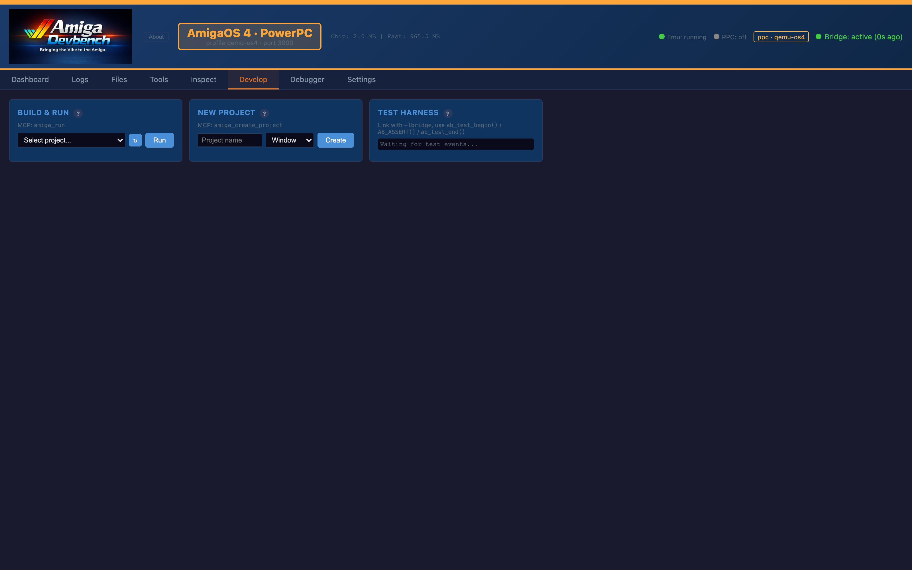
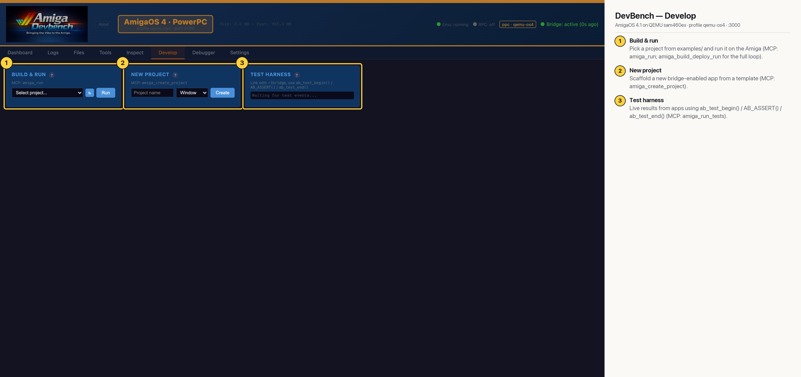

# DevBench — Develop (AmigaOS 4 PPC)

Project-level actions: pick one of the `examples/` projects and run it on the Amiga, scaffold a new bridge-enabled project from a template, and watch live results from apps that use the bridge test harness (`ab_test_begin()` / `AB_ASSERT()` / `ab_test_end()`). From Claude Code the whole edit → build → deploy → run loop is one call: `amiga_build_deploy_run`.

## Annotated

1. **Build & run** — Pick a project from examples/ and run it on the Amiga (MCP: amiga_run; amiga_build_deploy_run for the full loop).
2. **New project** — Scaffold a new bridge-enabled app from a template (MCP: amiga_create_project).
3. **Test harness** — Live results from apps using ab_test_begin() / AB_ASSERT() / ab_test_end() (MCP: amiga_run_tests).
