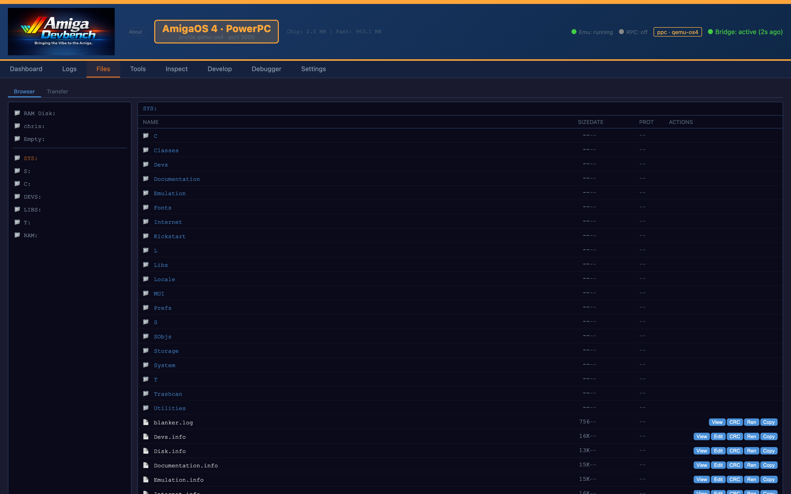
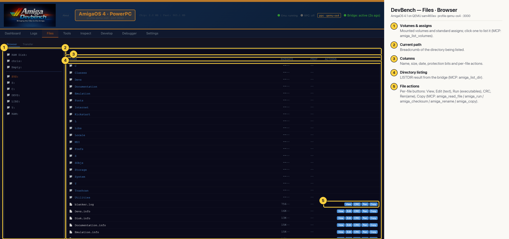

# DevBench — Files · Browser (AmigaOS 4 PPC)

Browse the Amiga's filesystem over the bridge: volumes and assigns on the left, a LISTDIR of the selected directory on the right, with per-file View / Edit / Run / CRC / Rename / Copy buttons. Useful for checking that a deploy landed and for poking at config files without touching the emulator window (MCP: `amiga_list_volumes`, `amiga_list_dir`, `amiga_read_file`).

## Annotated

1. **Volumes & assigns** — Mounted volumes and standard assigns; click one to list it (MCP: amiga_list_volumes).
2. **Current path** — Breadcrumb of the directory being listed.
3. **Columns** — Name, size, date, protection bits and per-file actions.
4. **Directory listing** — LISTDIR result from the bridge (MCP: amiga_list_dir).
5. **File actions** — Per-file buttons: View, Edit (text), Run (executables), CRC, Ren(ame), Copy (MCP: amiga_read_file / amiga_run / amiga_checksum / amiga_rename / amiga_copy).
