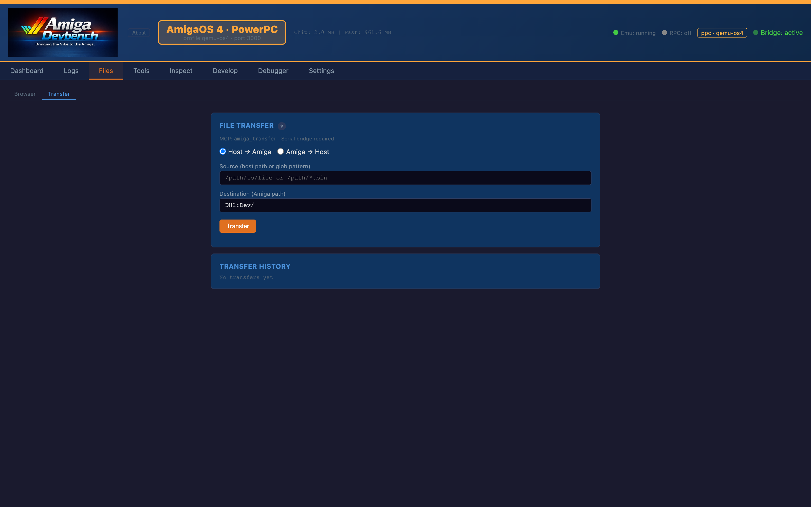
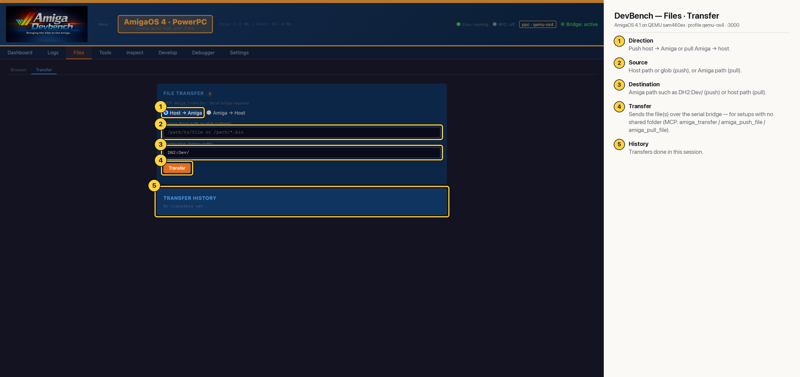

# DevBench — Files · Transfer (AmigaOS 4 PPC)

Push files from the host to the Amiga, or pull them back, over the serial bridge itself. This is for setups with no shared folder or writable hardfile. A glob can send several files at once (MCP: `amiga_transfer`, `amiga_push_file`, `amiga_pull_file`).

## Annotated

1. **Direction** — Push host → Amiga or pull Amiga → host.
2. **Source** — Host path or glob (push), or Amiga path (pull).
3. **Destination** — Amiga path such as DH2:Dev/ (push) or host path (pull).
4. **Transfer** — Sends the file(s) over the serial bridge — for setups with no shared folder (MCP: amiga_transfer / amiga_push_file / amiga_pull_file).
5. **History** — Transfers done in this session.
