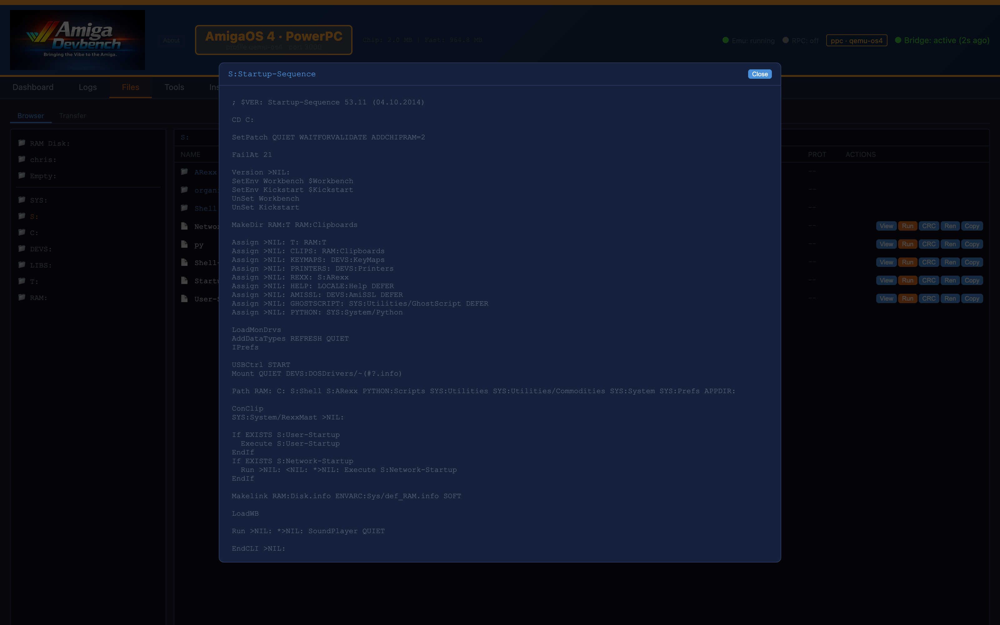
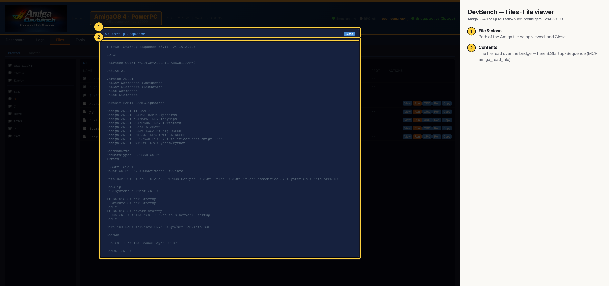

# DevBench — Files · File viewer (AmigaOS 4 PPC)

Clicking View on a file opens it in a modal, read over the bridge. Here it's the OS4 guest's `S:Startup-Sequence` (MCP: `amiga_read_file`).

## Annotated

1. **File & close** — Path of the Amiga file being viewed, and Close.
2. **Contents** — The file read over the bridge — here S:Startup-Sequence (MCP: amiga_read_file).
