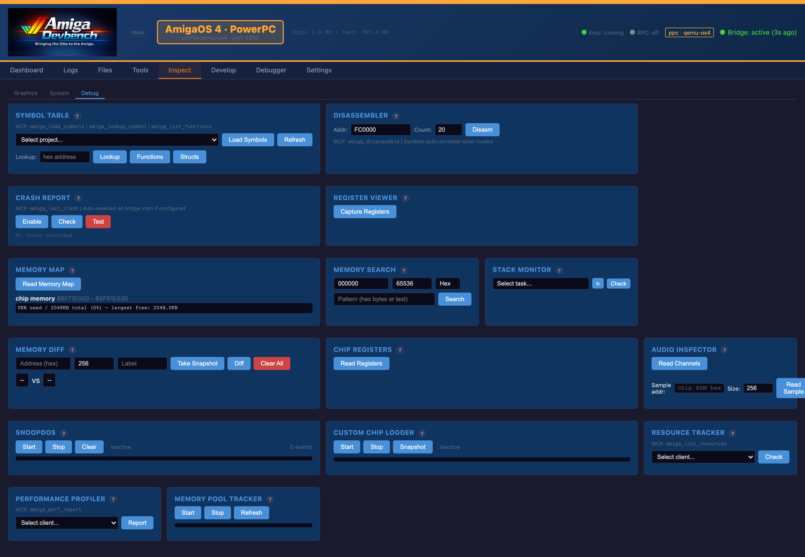
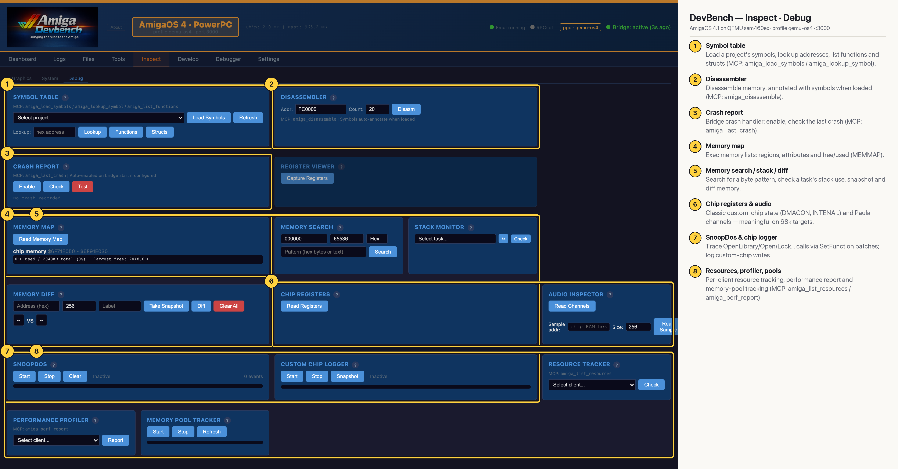

# DevBench — Inspect · Debug (AmigaOS 4 PPC)

Low-level debugging aids that work through the bridge: symbol loading and lookup, a disassembler, the crash handler's last report, the Exec memory map, memory search/diff, stack checks, custom-chip registers, Paula audio state, SnoopDos-style call tracing, a chip-write logger, and per-client resource, performance and pool tracking (MCP: `amiga_disassemble`, `amiga_last_crash`, `amiga_audio_channels`, `amiga_list_resources`, `amiga_perf_report`). On OS4 the chip-register and audio cards don't apply (sam460ex has no classic chipset); the memory map shows the Exec memory list.

## Annotated

1. **Symbol table** — Load a project's symbols, look up addresses, list functions and structs (MCP: amiga_load_symbols / amiga_lookup_symbol).
2. **Disassembler** — Disassemble memory, annotated with symbols when loaded (MCP: amiga_disassemble).
3. **Crash report** — Bridge crash handler: enable, check the last crash (MCP: amiga_last_crash).
4. **Memory map** — Exec memory lists: regions, attributes and free/used (MEMMAP).
5. **Memory search / stack / diff** — Search for a byte pattern, check a task's stack use, snapshot and diff memory.
6. **Chip registers & audio** — Classic custom-chip state (DMACON, INTENA…) and Paula channels — meaningful on 68k targets.
7. **SnoopDos & chip logger** — Trace OpenLibrary/Open/Lock… calls via SetFunction patches; log custom-chip writes.
8. **Resources, profiler, pools** — Per-client resource tracking, performance report and memory-pool tracking (MCP: amiga_list_resources / amiga_perf_report).
