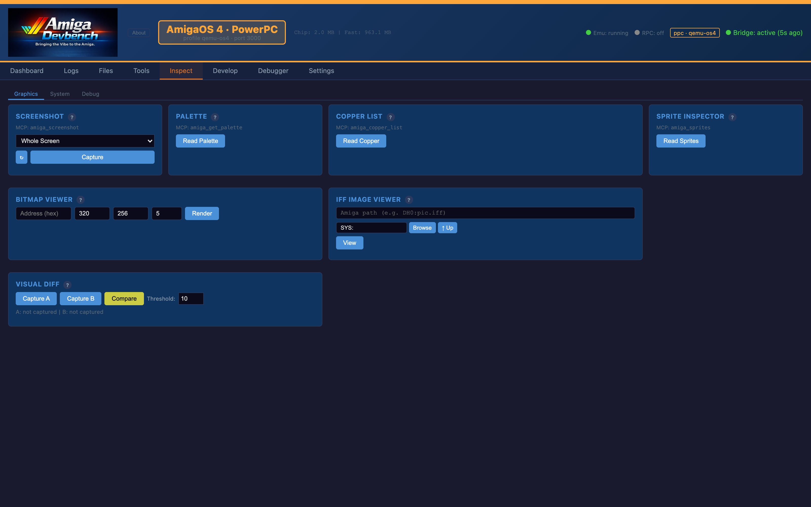
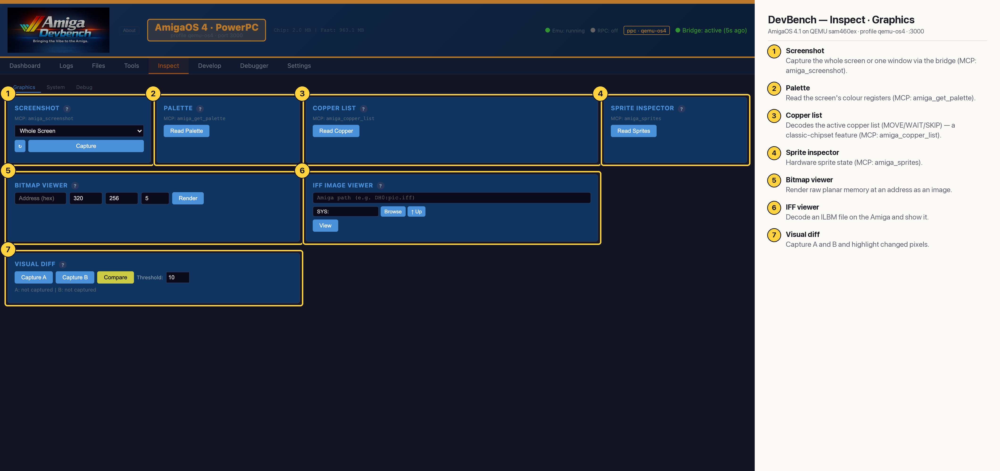

# DevBench — Inspect · Graphics (AmigaOS 4 PPC)

Graphics inspection tools: bridge screenshots of the screen or a single window, the palette, the active copper list, hardware sprites, a raw bitmap renderer, an IFF ILBM viewer and a visual diff between two captures (MCP: `amiga_screenshot`, `amiga_get_palette`, `amiga_copper_list`, `amiga_sprites`). The copper and sprite tools are classic-chipset features, so they matter on 68k (see the 68k capture). On OS4 this tab is mostly used for screenshots.

## Annotated

1. **Screenshot** — Capture the whole screen or one window via the bridge (MCP: amiga_screenshot).
2. **Palette** — Read the screen's colour registers (MCP: amiga_get_palette).
3. **Copper list** — Decodes the active copper list (MOVE/WAIT/SKIP) — a classic-chipset feature (MCP: amiga_copper_list).
4. **Sprite inspector** — Hardware sprite state (MCP: amiga_sprites).
5. **Bitmap viewer** — Render raw planar memory at an address as an image.
6. **IFF viewer** — Decode an ILBM file on the Amiga and show it.
7. **Visual diff** — Capture A and B and highlight changed pixels.
