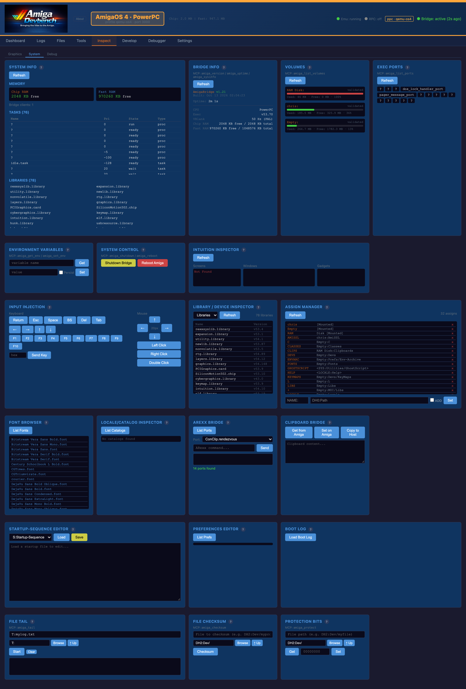
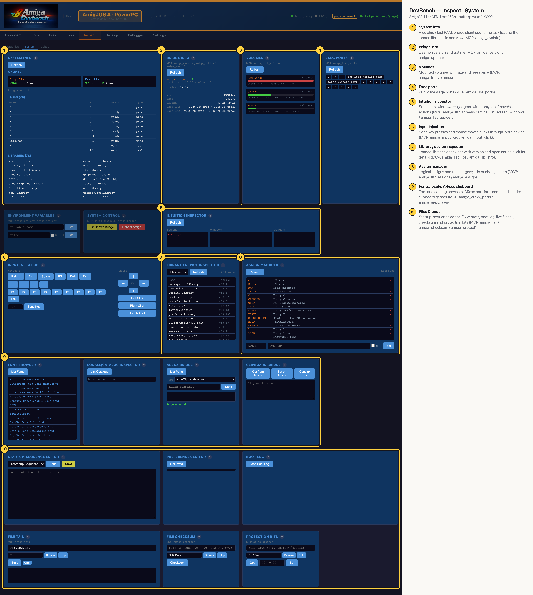

# DevBench — Inspect · System (AmigaOS 4 PPC)

Read-only views of the running OS plus a few controls: system and bridge info, volumes, public message ports, the Intuition screen/window/gadget tree, the library and device inspector, assigns, fonts, locale catalogs, ARexx ports and the clipboard, plus startup-sequence, ENV: prefs, boot-log, file-tail, checksum and protection-bit tools. Input injection and Shutdown/Reboot live here too. Each card is backed by MCP tools such as `amiga_sysinfo`, `amiga_list_libs` and `amiga_list_screens`.

## Annotated

1. **System info** — Free chip / fast RAM, bridge client count, the task list and the loaded libraries in one view (MCP: amiga_sysinfo).
2. **Bridge info** — Daemon version and uptime (MCP: amiga_version / amiga_uptime).
3. **Volumes** — Mounted volumes with size and free space (MCP: amiga_list_volumes).
4. **Exec ports** — Public message ports (MCP: amiga_list_ports).
5. **Intuition inspector** — Screens → windows → gadgets, with front/back/move/size actions (MCP: amiga_list_screens / amiga_list_screen_windows / amiga_list_gadgets).
6. **Input injection** — Send key presses and mouse moves/clicks through input.device (MCP: amiga_input_key / amiga_input_click).
7. **Library / device inspector** — Loaded libraries or devices with version and open count; click for details (MCP: amiga_list_libs / amiga_lib_info).
8. **Assign manager** — Logical assigns and their targets; add or change them (MCP: amiga_list_assigns / amiga_assign).
9. **Fonts, locale, ARexx, clipboard** — Font and catalog browsers, ARexx port list + command sender, clipboard get/set (MCP: amiga_arexx_ports / amiga_arexx_send).
10. **Files & boot** — Startup-sequence editor, ENV: prefs, boot log, live file tail, checksum and protection bits (MCP: amiga_tail / amiga_checksum / amiga_protect).
