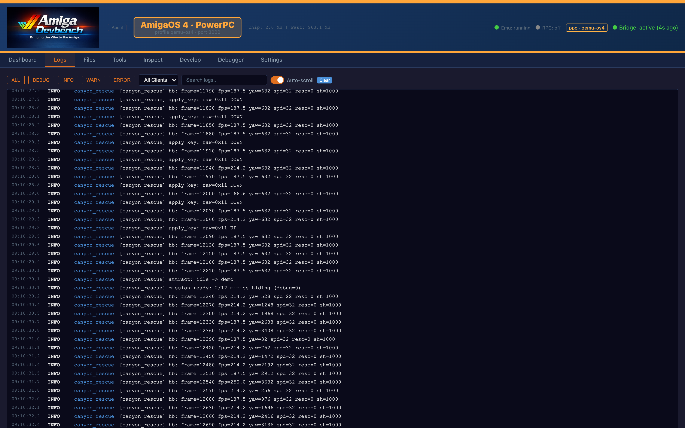
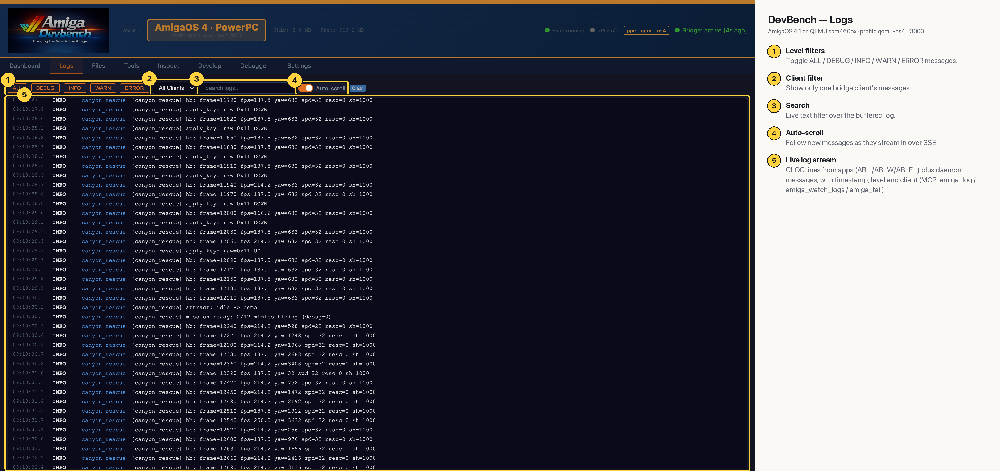

# DevBench — Logs (AmigaOS 4 PPC)

Every `AB_I`/`AB_W`/`AB_E` line an app sends through the bridge client library (CLOG messages), streamed live over server-sent events. Filter by level, client or text while a program runs; this is the inner-loop printf view. Claude reads the same buffer with `amiga_log`, `amiga_watch_logs` and `amiga_tail`. Here the stream is a game's per-frame heartbeat lines.

## Annotated

1. **Level filters** — Toggle ALL / DEBUG / INFO / WARN / ERROR messages.
2. **Client filter** — Show only one bridge client's messages.
3. **Search** — Live text filter over the buffered log.
4. **Auto-scroll** — Follow new messages as they stream in over SSE.
5. **Live log stream** — CLOG lines from apps (AB_I/AB_W/AB_E…) plus daemon messages, with timestamp, level and client (MCP: amiga_log / amiga_watch_logs / amiga_tail).
