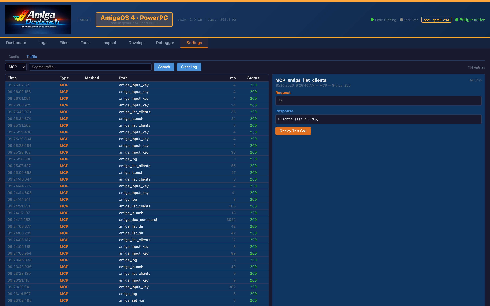
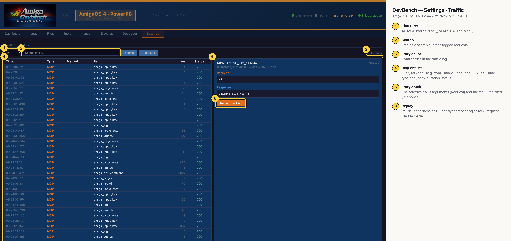

# DevBench — Settings · Traffic (AmigaOS 4 PPC)

Every MCP tool call (from Claude Code or any other MCP client) and every REST call the web UI makes is logged with timing and status. Select an entry to see its request and response, or replay it. The list here, filtered to MCP, shows calls made by agents driving the OS4 guest at the time (`amiga_input_key`, `amiga_launch`, `amiga_list_clients`, …). Useful for seeing exactly what Claude did.

## Annotated

1. **Kind filter** — All, MCP tool calls only, or REST API calls only.
2. **Search** — Free-text search over the logged requests.
3. **Entry count** — Total entries in the traffic log.
4. **Request list** — Every MCP call (e.g. from Claude Code) and REST call: time, type, tool/path, duration, status.
5. **Entry detail** — The selected call's arguments (Request) and the result returned (Response).
6. **Replay** — Re-issue the same call — handy for repeating an MCP request Claude made.
