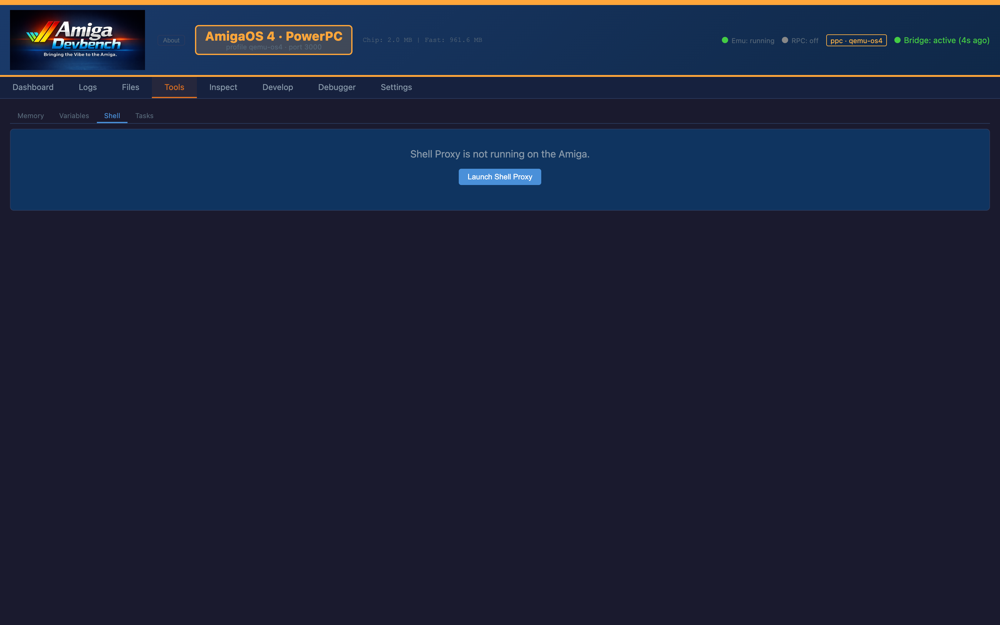
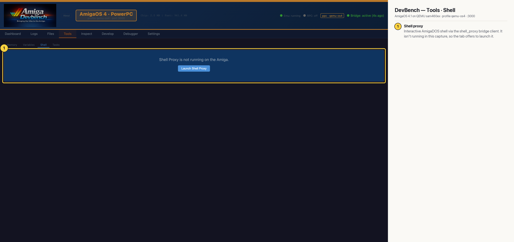

# DevBench — Tools · Shell (AmigaOS 4 PPC)

An interactive AmigaDOS shell in the browser, via the `shell_proxy` bridge client, with history, tab completion and aliases. The proxy wasn't running when this was captured, so the tab offers to launch it. Claude runs one-off commands with `amiga_dos_command` / `amiga_exec` instead.

## Annotated

1. **Shell proxy** — Interactive AmigaDOS shell via the shell_proxy bridge client. It isn't running in this capture, so the tab offers to launch it.
