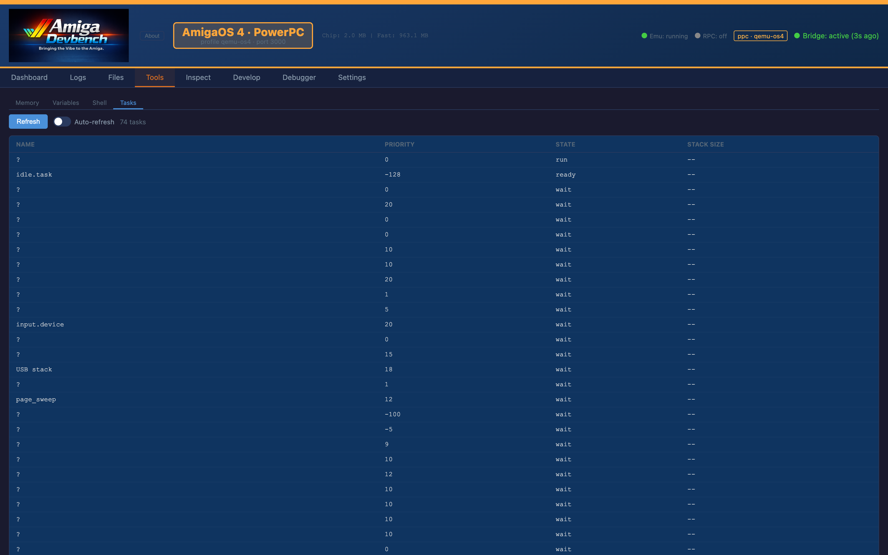
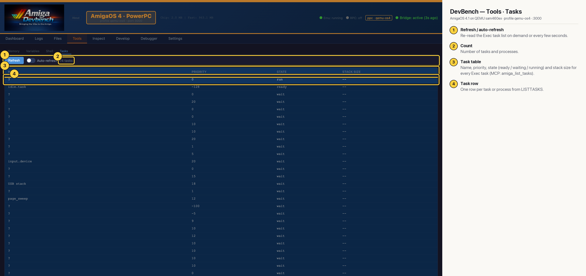

# DevBench — Tools · Tasks (AmigaOS 4 PPC)

The Exec task list (LISTTASKS): name, priority, state and stack size, refreshed on demand or automatically. Use it to confirm a program started, or to find out what is hogging the CPU. On this OS4 build many task names come back as `?` (MCP: `amiga_list_tasks`).

## Annotated

1. **Refresh / auto-refresh** — Re-read the Exec task list on demand or every few seconds.
2. **Count** — Number of tasks and processes.
3. **Task table** — Name, priority, state (ready / waiting / running) and stack size for every Exec task (MCP: amiga_list_tasks).
4. **Task row** — One row per task or process from LISTTASKS.
