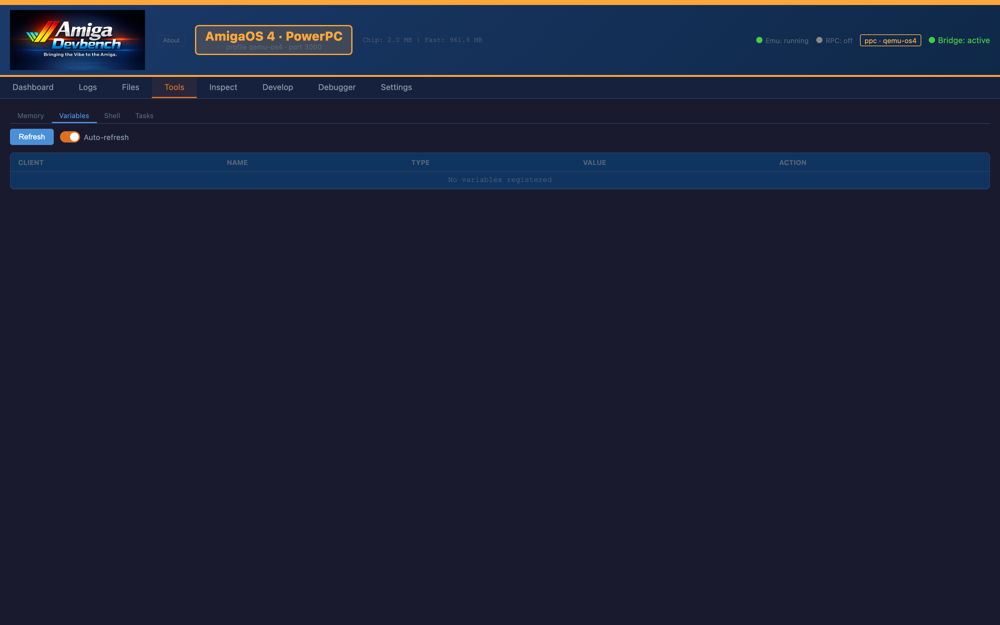
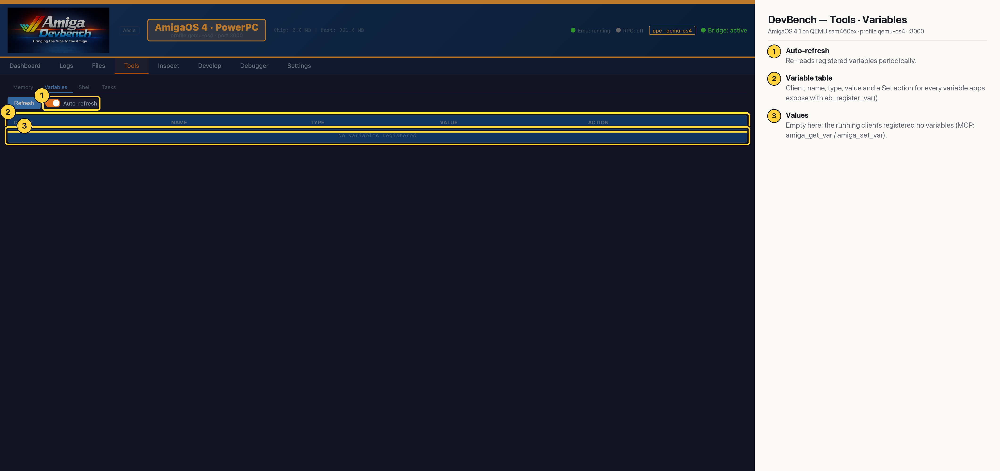

# DevBench — Tools · Variables (AmigaOS 4 PPC)

Variables an app exposes with `ab_register_var()` appear here and can be read or changed live: tune a game's speed or gravity without rebuilding. The clients running during this capture registered none, so the table is empty (MCP: `amiga_get_var`, `amiga_set_var`).

## Annotated

1. **Auto-refresh** — Re-reads registered variables periodically.
2. **Variable table** — Client, name, type, value and a Set action for every variable apps expose with ab_register_var().
3. **Values** — Empty here: the running clients registered no variables (MCP: amiga_get_var / amiga_set_var).
